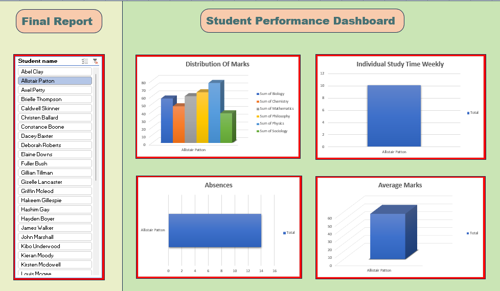

# Student Performance Dashboard | Microsoft Excel

## Project Overview

The Student Performance Dashboard is an Excel-based data analysis project designed to evaluate academic performance across six subjects. It uses Excel formulas, PivotTables, and charts to summarize student marks, weekly study time, and absences in an interactive dashboard.

The project demonstrates practical skills in data validation, formula-based calculations, data summarization, and dashboard development.

## Objectives

- Analyze student performance across six academic subjects.
- Compare average marks to identify subject-wise performance differences.
- Examine weekly study time and student absences.
- Develop a dashboard to communicate findings through visualizations.
- Apply Excel techniques to transform raw data into meaningful insights.

## Tools and Technologies

- **Microsoft Excel**
- Excel formulas: `IF`, `AVERAGE`, `SUM`
- PivotTables and PivotCharts
- Data validation and calculated columns
- Charts and dashboard design

## Dataset Description

The workbook contains data for 39 students across six subjects:

- Chemistry
- Biology
- Mathematics
- Philosophy
- Physics
- Sociology

Additional student-level attributes include weekly study time, absences, attendance-related information, academic grades, and other student characteristics.

The workbook contains separate subject worksheets, a student-details worksheet, a PivotTable worksheet, and a dashboard worksheet.

## Project Workflow

### 1. Data Understanding and Validation

- Examined the structure of the student-level dataset and subject-wise worksheets.
- Checked student identifiers and compared subject scores across worksheets.
- Reviewed differences in student coverage across subjects.
- Validated calculated columns and source data used in dashboard visualizations.

### 2. Data Analysis Using Excel Formulas

Applied Excel functions to calculate and evaluate academic performance:

- `AVERAGE()` — calculates average marks across subjects.
- `IF()` — classifies scores based on a defined threshold.
- `SUM()` — calculates total marks across subjects.

### 3. PivotTable Analysis

Used PivotTables to summarize student records and organize information for dashboard reporting.

The analysis covers:

- Subject-wise average marks
- Weekly study time
- Student absences
- Student-level average marks

### 4. Dashboard Development

Created an Excel dashboard with four visualizations to present key performance indicators and student-level comparisons.

The dashboard includes:

- Distribution of Marks
- Individual Study Time Weekly
- Absences
- Average Marks

## Key Findings

The subject-wise analysis produced the following average marks:

| Subject | Average Marks |
|---|---:|
| Sociology | 56.72 |
| Physics | 63.62 |
| Chemistry | 60.48 |
| Mathematics | 50.10 |
| Biology | 48.31 |
| Philosophy | 48.00 |

**Key observations:**

- Physics recorded the highest average score at 63.62 out of 100.
- Philosophy recorded the lowest average score at 48.00 out of 100.
- Subject-level averages varied across the six subjects.
- Differences in student counts should be considered when interpreting subject comparisons.

## Dashboard Preview

## Skills Demonstrated

- Microsoft Excel
- Data Cleaning and Validation
- Excel Formulas
- PivotTables and PivotCharts
- Exploratory Data Analysis
- Data Visualization
- Dashboard Development
- Analytical Thinking

## Limitations

- Student counts differ across subject worksheets.
- Subject averages are descriptive and do not establish the causes of performance differences.
- Study time and absences alone cannot establish a causal relationship with academic outcomes.
- Student-level information should be anonymized before the workbook is shared publicly.

## Future Improvements

- Add KPI cards for overall average marks and subject-level performance.
- Improve interactivity through slicers and consistent filtering.
- Add a study-time-versus-marks analysis to explore potential relationships.
- Develop a Power BI version with role-based access control for authorized student-level reporting.
- Automate data preparation and validation to improve reproducibility.
---

*This project was developed for educational and portfolio purposes.*
